
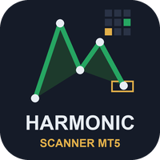

# Harmonic Scanner (MetaTrader 5 and MetaTrader 4)

A scanner indicator that watches **many symbols and timeframes for eight harmonic patterns** in one panel on your chart, shows where a pattern has just reached its reversal zone or is close to it, and sends an alert.

> **This is a showcase repository: documentation and images only. There is no source code here.** The product is sold on
> the MQL5 Market. The free indicator it relates to has public source:
> [allanninal/harmonic-signal-alerts](https://github.com/allanninal/harmonic-signal-alerts).

**Website:** [allanninal.dev/mql5 (indicators)](https://www.allanninal.dev/mql5/#indicators) · [MT4 editions](https://www.allanninal.dev/mql5/#mt4) · [allanninal.dev](https://www.allanninal.dev)
· **Contact:** message me on [LinkedIn](https://www.linkedin.com/in/allanninal/).

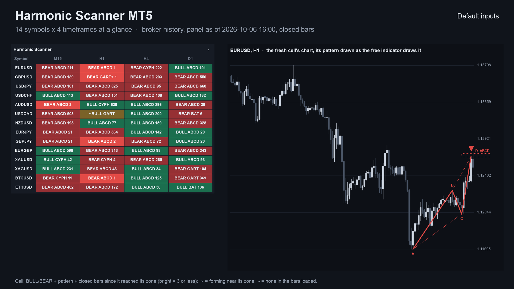

## Get it on the MQL5 Market

| Product | Platform | Price | Link |
|---|---|---|---|
| **Harmonic Scanner** | MT5 | paid | <https://www.mql5.com/en/market/product/201814> |
| **Harmonic Scanner Pro MT4** | MT4 | paid | <https://www.mql5.com/en/market/product/202421> |
| Harmonic Signal Alerts (source on GitHub) | MT5 | free | <https://www.mql5.com/en/market/product/201811> |
| Harmonic Signal Alerts MT4 (source on GitHub) | MT4 | free | <https://www.mql5.com/en/market/product/202361> |

The paid product is standalone: you do not need to install the free indicator to use it. Details, current price and the
Strategy Tester demo are on the Market pages.

## What it does

- A panel on the chart with **symbols as rows and timeframes as columns** (Market Watch symbols, or your own list).
- **Eight patterns:** the three of the free indicator (ABCD, Gartley, Bat) plus five more. See the Market listing for the list.
- **Completed:** a cell shows the pattern, its direction and how many bars ago it reached its reversal zone; fresh ones are highlighted.
- **Forming:** a cell can also show a pattern whose swings are confirmed and whose price is close to its zone (the distance is adjustable); it is not complete until a closed bar reaches the zone.
- An **outcome table**: for each pattern, how often price moved part of the way back after the zone before a stop beyond the zone was hit. The stop is adjustable and changes the numbers a lot, so it is shown as past behaviour, not a forecast.
- **Alerts** when a forming pattern comes near its zone and when a pattern reaches it: pop-up (on by default), sound, push notification, e-mail. Nothing is sent while history loads, never twice for the same cell and bar, and not in the Strategy Tester. Alerts of the same second come as one message.
- **Click a cell** to open that symbol and timeframe.
- **Completed patterns come from confirmed swings and closed bars only** and never change afterwards. Forming ones are, by nature, not final, and the panel labels them as forming.

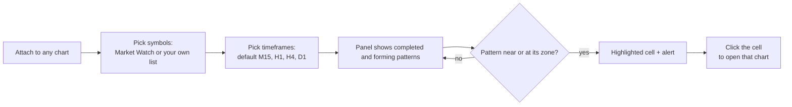

### The grid at a glance

Each cell is one symbol on one timeframe. You read a whole watchlist in a single look instead of flipping through charts.

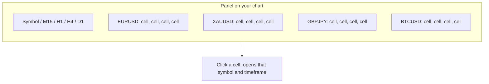

### What a cell can show

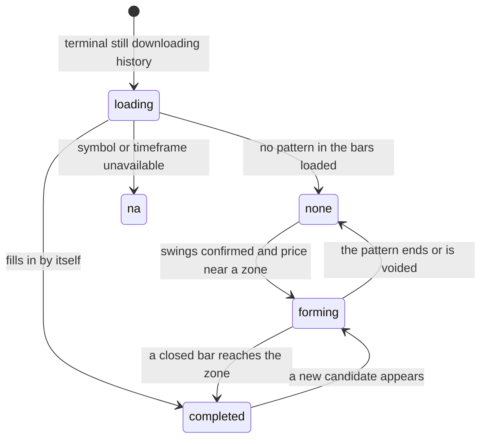

| | |
|---|---|
|  | 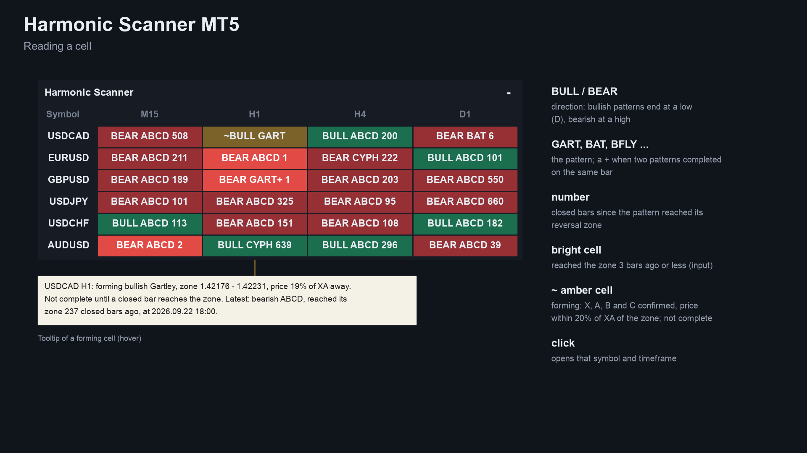 |
| 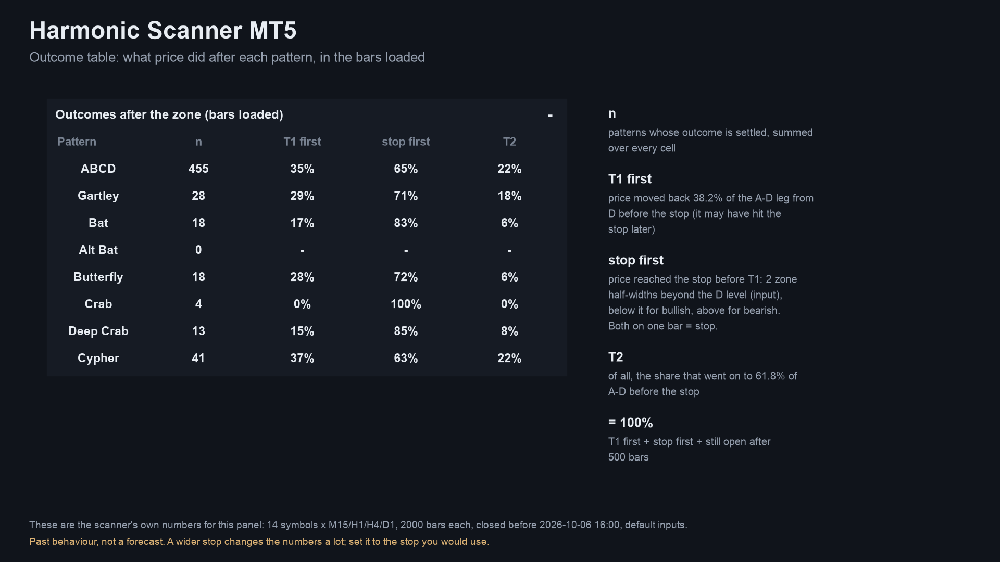 | 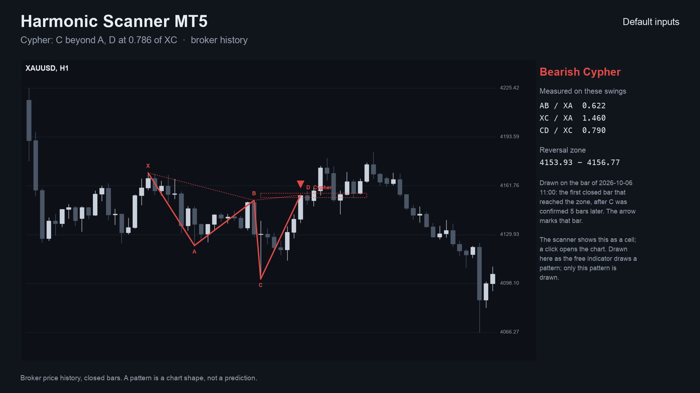 |
| 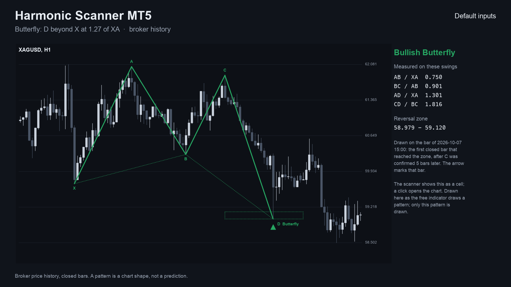 | 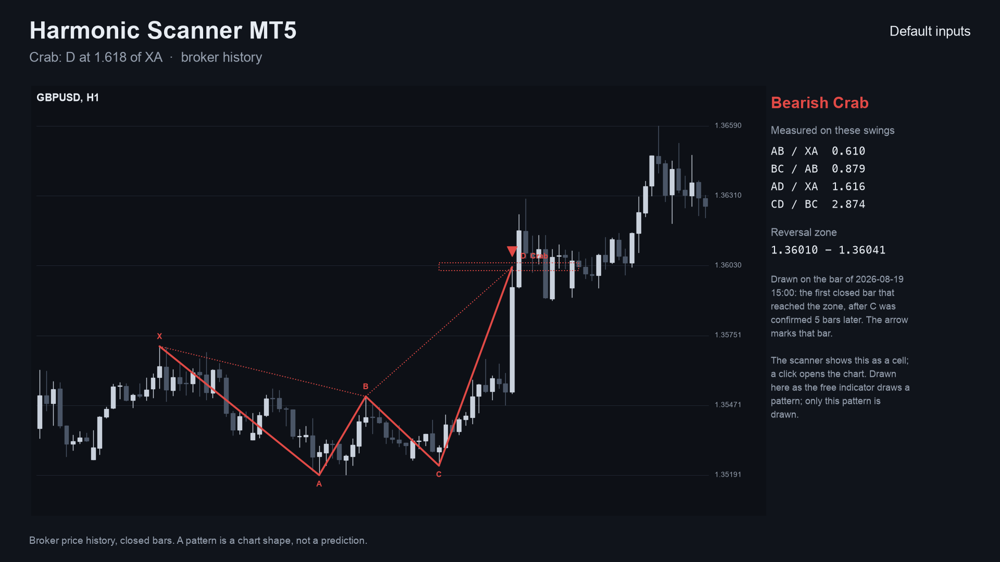 |
| 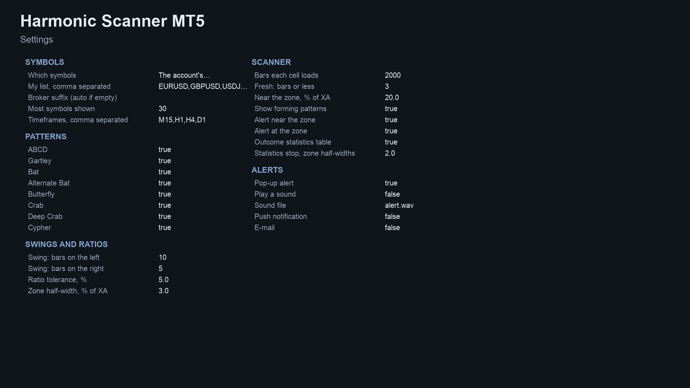 |  |

MT4 edition screenshots: [panel on a chart](images/mt4/01-scanner-on-chart.png), [how to read a cell](images/mt4/02-reading-a-cell.png), [outcome table](images/mt4/03-outcome-statistics.png). Some screenshots are illustrations built from broker history, not terminal captures.

## Who it is for

Traders who use harmonic patterns on several symbols. If you watch one chart, the free [Harmonic Signal Alerts](https://www.mql5.com/en/market/product/201811) draws ABCD, Gartley and Bat there.

## Why it was built

- Harmonic patterns are a well-known method, and the free indicator covers one chart at a time.
- Our October 2026 market research (MQL5 Market, TradingView, forums, freelance boards) found harmonic scanners are requested and sold, but it is a niche with several established products (on the order of 90 harmonic indicators on the Market). So this is a smaller-scale tool for people who already use the method, not a claim of unmet demand.
- Design rule carried over from the free indicator: trust. Completed patterns use confirmed swings and closed bars, so what you saw does not change.

## How it was checked (results)

The swing and ratio engine is shared with the free indicator, which matched an independent Python calculation on every bar and passed an every-tick repaint test. For the scanner, every pattern, forming candidate, latest-pattern value and outcome counter was compared with the same Python calculation with all eight patterns on.

| Check | MT5 edition | MT4 edition |
|---|---|---|
| Test files compared | 32 (EURUSD, GBPJPY, XAUUSD, BTCUSD x M15, H1, H4, D1 x 2 settings) | 108 (the same four symbols x M15, H1, H4, D1, two settings) |
| Result | engine and cell loader: 0 mismatches | 1,091,830 bar records compared, 0 differences |
| Panel counts vs the test's own cells | - | 8,674,389 checks matched after start-up |
| Cells using the forming bar | none | none |

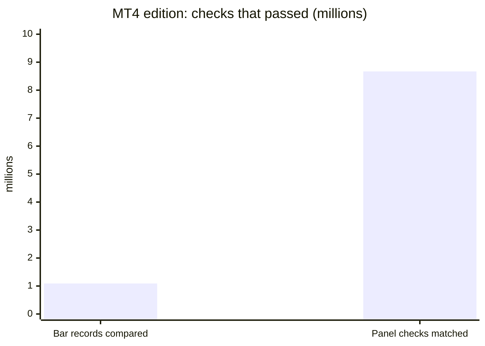

These are code checks, not trading results. The outcome table is descriptive: it changes with the stop you choose, and it is not an edge.

## Honest limits

- A scanner shows the state of a technical rule. It does not predict the market, and past patterns are no indication of future results. No profit or accuracy claim is made.
- A swing is known a few bars after it formed, so a pattern appears a few bars after its turning points, never earlier.
- Ratios and tolerances differ between authors; counts will differ from other tools.
- It is an indicator: it places no orders and manages no risk.
- It needs the terminal running to alert, and push needs your MetaQuotes ID set up in the terminal.
- The source is not published; this repository documents what the product does and the results of its checks.

## Free vs paid

| | Harmonic Signal Alerts (free) | Harmonic Scanner (paid) |
|---|---|---|
| Scope | one chart | many symbols x timeframes in one panel |
| Patterns | 3 | 8 |
| Output | lines, zone and arrow on the chart | completed and forming cells, outcome table |
| Alerts | pop-up, sound, push, e-mail | pop-up, sound, push, e-mail |
| MT5 | [201811](https://www.mql5.com/en/market/product/201811) | [201814](https://www.mql5.com/en/market/product/201814) |
| MT4 | [202361](https://www.mql5.com/en/market/product/202361) | [202421](https://www.mql5.com/en/market/product/202421) (Pro MT4) |
| Source | [public on GitHub](https://github.com/allanninal/harmonic-signal-alerts) | not published |

---

**Website:** [allanninal.dev/mql5](https://www.allanninal.dev/mql5/#indicators) · [MT4](https://www.allanninal.dev/mql5/#mt4) · [allanninal.dev](https://www.allanninal.dev)
· Questions: message me on [LinkedIn](https://www.linkedin.com/in/allanninal/). All rights reserved, see [LICENSE](LICENSE).
Copyright 2026 Allan Niñal (https://www.allanninal.dev/mql5). All rights reserved.

This repository contains documentation and images only; it contains no source code. The text and images may not be
copied, redistributed or used commercially without written permission. The Harmonic Scanner products themselves are
distributed only through the MQL5 Market under the Market's own terms.
